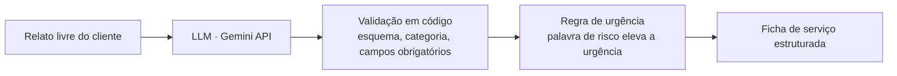

<pre>
███████╗██████╗ ██╗   ██╗ █████╗ ██████╗ ██████╗  ██████╗ 
██╔════╝██╔══██╗██║   ██║██╔══██╗██╔══██╗██╔══██╗██╔═══██╗
█████╗  ██║  ██║██║   ██║███████║██████╔╝██║  ██║██║   ██║
██╔══╝  ██║  ██║██║   ██║██╔══██║██╔══██╗██║  ██║██║   ██║
███████╗██████╔╝╚██████╔╝██║  ██║██║  ██║██████╔╝╚██████╔╝
╚══════╝╚═════╝  ╚═════╝ ╚═╝  ╚═╝╚═╝  ╚═╝╚═════╝  ╚═════╝ 
</pre>
<h1>Olá, eu sou o Eduardo! 👋</h1>
<h3>Desenvolvedor de Software em Formação · Foco em IA Generativa 🚀</h3>

<i>Transformando problemas reais em software, com IA que funciona de verdade.</i>

📍 Betim, MG &nbsp;·&nbsp; 🎓 PUC Minas (ADS) &nbsp;·&nbsp; 🔎 Buscando estágio em Engenharia de Software com foco em IA

<a href="https://www.linkedin.com/in/eduardo-henrick-souza-lopes-7b56b6360"> <b>LinkedIn</b></a> &nbsp;·&nbsp; <a href="mailto:eduardohenrick900@gmail.com"> <b>eduardohenrick900@gmail.com</b></a>

## 👨‍💻 Sobre mim

Estudo **Análise e Desenvolvimento de Sistemas na PUC Minas** (conclusão prevista em dez/2027) e tenho formação técnica em Informática. Trabalhei em uma oficina de motos, vi o trabalho de ordens de serviço feito à mão e comecei a construir uma solução com IA para isso.

Hoje o meu foco é **integrar LLMs em software de forma confiável**: validar o que o modelo responde, versionar prompts e medir o resultado com casos de teste, em vez de confiar só em "parece que funciona".

- 🎓 Graduando em **Análise e Desenvolvimento de Sistemas** (PUC Minas), previsão dez/2027
- ⚙️ Back-end com **C# e ASP.NET Core**, e também JavaScript/TypeScript
- 🤖 Integração de LLM (**Google Gemini API**) em APIs e fluxos de automação
- 🗂️ Modelagem de banco de dados e de processos (BPMN)
- 📚 Imersão em **Dados e IA** (Santander Open Academy), em andamento
- 🔍 Aberto a **oportunidades de estágio**

---

## 🚀 Projetos em destaque

### 🔗 [OS Triage](https://github.com/EduardoHenrick2/OS-Triage): do relato do cliente à ficha de serviço

Fluxo com LLM que transforma o relato livre de um cliente de oficina de motos em uma ficha de serviço estruturada.

- ✅ Prompts versionados e **avaliados em 24 casos de teste com gabarito**
- 🛡️ A validação em código evita aceitar respostas fora do formato esperado
- 🧰 `n8n` · `Google Gemini API` · `JavaScript` · `Docker`

### 🔗 [OS Triage API](https://github.com/EduardoHenrick2/OS-Triage_API)

API que serve de base para o fluxo acima: recebe requisições REST e mensagens de bots de mensageria, com processamento por IA, para a triagem e a entrada de ordens de serviço.

- 🐳 Ambiente containerizado com Docker Compose, scripts de inicialização do banco e testes unitários
- 🧰 `C#` · `.NET` · `PostgreSQL` · `Docker`

### 🔗 [Green Estoque](https://github.com/EduardoHenrick2/green-estoque-TAIPN)

Sistema full-stack de controle de estoque para a **Green Volt** (energia solar), projeto de extensão na PUC Minas, em equipe interdisciplinar de 10 pessoas.

- 👤 Minha atuação: back-end (Node.js/Express), modelagem do banco (Prisma/PostgreSQL), modelagem de processos em BPMN e documentação
- 📐 Planejamento de uma API com nove módulos e esquema de seis tabelas
- 🧰 `React` · `Node.js` · `Express` · `Prisma` · `PostgreSQL`

---

## 🛠️ Stack & Tecnologias

| Área | Tecnologias |
|:---|:---|
| 💬 **Linguagens** |  C# &nbsp;&nbsp;  JavaScript &nbsp;&nbsp;  TypeScript &nbsp;&nbsp; SQL |
| ⚙️ **Back-end** |  ASP.NET Core &nbsp;&nbsp;  Node.js &nbsp;&nbsp; Express &nbsp;&nbsp; Prisma &nbsp;&nbsp; APIs REST |
| 🎨 **Front-end** |  React &nbsp;&nbsp;  HTML &nbsp;&nbsp;  CSS &nbsp;&nbsp;  Tailwind CSS &nbsp;&nbsp;  Vite |
| 🗄️ **Bancos de dados** |  PostgreSQL &nbsp;&nbsp;  MySQL |
| 🤖 **IA generativa** | Google Gemini API &nbsp;&nbsp; engenharia de prompts &nbsp;&nbsp; n8n |
| 🧰 **Ferramentas** |  Git &nbsp;&nbsp; GitHub &nbsp;&nbsp;  Visual Studio &nbsp;&nbsp;  VS Code &nbsp;&nbsp;  Figma &nbsp;&nbsp; Bizagi Modeler |

---

## 🌱 Estudando agora

- 🐍 **Python**, para trabalhar melhor com dados e avaliação de modelos
- 🧪 **Testes automatizados em C#**
- 🐳 **Docker**, indo além do básico
- 🔌 Integração de LLMs em APIs de forma mais robusta

---

## 📂 Outros repositórios

- 🔗 [Galeria Sonora](https://github.com/EduardoHenrick2/Galeria-Sonora)
- 🔗 [Atividades em C#](https://github.com/EduardoHenrick2/Atividades-em-C-): exercícios de lógica e algoritmos

---

<h3>💬 Vamos conversar?</h3>

Quer trocar ideia sobre software, IA ou oportunidades de estágio? Me chama!

<a href="https://www.linkedin.com/in/eduardo-henrick-souza-lopes-7b56b6360"> <b>LinkedIn</b></a> &nbsp;·&nbsp; <a href="mailto:eduardohenrick900@gmail.com"> <b>E-mail</b></a>

<i>"Todo expert já foi um dia um iniciante."</i> ✨

